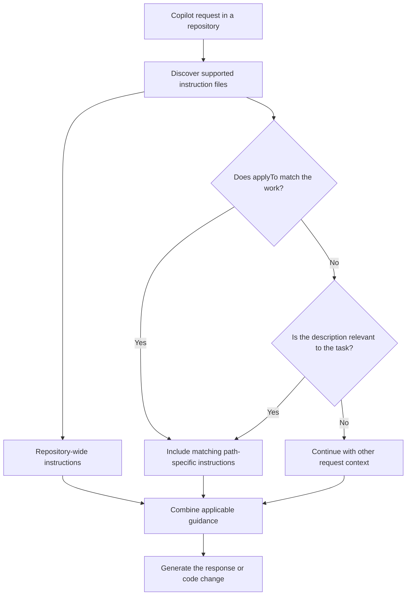

# Copilot Instructions

This directory holds reusable instruction files authored in
`electrocucaracha/gh-workflows`.
They give GitHub Copilot project guidance as Markdown context;
they do not execute commands or enforce checks by themselves.

## Instruction Types

| Type               | Location                                                  | When Copilot considers it                                                                                                        |
| ------------------ | --------------------------------------------------------- | -------------------------------------------------------------------------------------------------------------------------------- |
| Repository-wide    | `.github/copilot-instructions.md`                         | For requests in that repository, when supported by the selected Copilot surface.                                                 |
| Path-specific      | `.github/instructions/*.instructions.md`                  | When `applyTo` matches files being created or changed. A `description` can also help Copilot select guidance relevant to a task. |
| Agent instructions | `AGENTS.md` or harness-specific files such as `CLAUDE.md` | According to the selected agent harness and its discovery rules.                                                                 |

For path-specific files, `applyTo` uses glob patterns relative to the repository
root.
For example, `**/*.py` targets Python files throughout the repository.
If an instruction file has no `applyTo` or relevant `description`, attach it
manually when needed.

In Visual Studio Code, matching instruction files are added to agent requests for files
the agent creates or modifies.
On GitHub.com, path-specific instructions are currently supported for Copilot
coding agent and code review.
Support can vary by Copilot surface and selected harness.
These instructions do not affect inline code completions.

## Discovery Flow



Applicable sources are additive.
Do not rely on a fixed order or precedence between instruction files.
Resolve contradictions at their source and keep shared rules consistent with
repository-specific requirements.

To check whether Copilot used an instruction, inspect the response references
or the Agent Debug Logs in Visual Studio Code.
Discovery and actual adherence are separate; validate important requirements
with the repository's tests, linters, or CI checks.

## Shared Files Here

| File                                                                                             | `applyTo` pattern             | Purpose                                                                       |
| ------------------------------------------------------------------------------------------------ | ----------------------------- | ----------------------------------------------------------------------------- |
| [markdown-semantic-line-breaks.instructions.md](./markdown-semantic-line-breaks.instructions.md) | `**/*.md`                     | Write readable Markdown with semantic line breaks while preserving structure. |
| [python.instructions.md](./python.instructions.md)                                               | `**/*.py`                     | General Python implementation and testing conventions.                        |
| [shell.instructions.md](./shell.instructions.md)                                                 | `**/*.sh`                     | Safe, maintainable shell scripting across repository-specific shells.         |
| [go.instructions.md](./go.instructions.md)                                                       | `**/*.go,**/go.mod,**/go.sum` | General idiomatic Go conventions.                                             |
| [makefile.instructions.md](./makefile.instructions.md)                                           | Makefile patterns             | Readable, maintainable Make rules.                                            |

Each target repository still owns its architecture, supported versions, test
commands, and special compatibility or documentation rules.
Keep those local when they do not apply to every consumer.

## Propagation

Copilot does not fetch these files from this repository when working in another
repository.
To make the shared guidance available there, copy the files into that
repository's `.github/instructions` directory.

Run the helper from this repository with one or more local clone paths:

```sh
ci/sync_instructions.sh /path/to/repository
```

The default mode previews the files to be copied.
Use `--apply` to add missing files; it stops before writing if a same-named
file differs.
After reviewing the preview and any conflicts, use `--replace` to synchronize
the target with the central versions.

The helper only copies instruction files.
It does not delete files, create pull requests, or push changes.
Review and commit each consuming repository's updates through its normal
workflow.

For centrally managed instructions across repositories, consider GitHub
organization-level Copilot instructions where your Copilot plan and surfaces
support them.
Repository copies remain useful for path-specific guidance and projects that
do not receive organization instructions.

## References

- [Visual Studio Code: Use custom instructions](https://code.visualstudio.com/docs/copilot/customization/custom-instructions)
- [GitHub: Add repository custom instructions](https://docs.github.com/en/copilot/customizing-copilot/adding-repository-custom-instructions-for-github-copilot)
