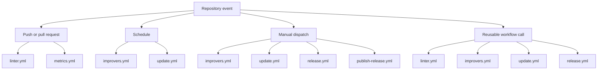

# Available Workflows

This directory contains GitHub Actions workflows for repository validation,
metrics,
maintenance,
and releases.
All except [metrics.yml](./metrics.yml) support reusable workflow calls.

## Choose a workflow

- Use [linter.yml](./linter.yml) to validate a change with Super-Linter.
- Use [metrics.yml](./metrics.yml) to report source lines of code.
- Use [improvers.yml](./improvers.yml) to run scheduled or manual code-quality improvement tasks.
- Use [update.yml](./update.yml) to refresh managed dependency versions and open a pull request with the changes.
- Use [release.yml](./release.yml) to propose release notes in a pull request,
  then [publish-release.yml](./publish-release.yml) to publish the reviewed
  semantic version tag and GitHub release.

## Event map



## Workflow reference

| Workflow                                     | Responsibilities                                                                                                         | Events                                           |
| :------------------------------------------- | :----------------------------------------------------------------------------------------------------------------------- | :----------------------------------------------- |
| [linter.yml](./linter.yml)                   | Runs Super-Linter validation. On failure, gathers diagnostics and asks the Copilot CLI to file or update a GitHub issue. | `push`, `pull_request`, `workflow_call`          |
| [metrics.yml](./metrics.yml)                 | Runs `scc` and reports repository source-line metrics.                                                                   | `push`, `pull_request`                           |
| [improvers.yml](./improvers.yml)             | Runs Copilot-driven tasks for technical debt, ignored-rule cleanup, test coverage, and a perspective review issue.       | `schedule`, `workflow_dispatch`, `workflow_call` |
| [update.yml](./update.yml)                   | Runs `ci/update_versions.sh` and opens a pull request for managed version changes.                                       | `schedule`, `workflow_dispatch`, `workflow_call` |
| [release.yml](./release.yml)                 | Proposes an AI-assisted changelog in a pull request, then publishes a reviewed tag and GitHub release on a second run.   | `workflow_dispatch`, `workflow_call`             |
| [publish-release.yml](./publish-release.yml) | Calls `release.yml` with `publish: true` to publish a reviewed release from the default branch.                          | `workflow_dispatch`                              |

## Schedule

- Scheduled workflows use UTC.
- [improvers.yml](./improvers.yml) runs at `00:00` on the 15th day of each month.
- [update.yml](./update.yml) runs at `00:00` every Friday.

You can run both maintenance workflows manually with `workflow_dispatch`.

## Reusable workflow requirements

### Job permissions

Grant the following `GITHUB_TOKEN` permissions on the caller job containing `uses`.
These are the permissions requested by the current workflow definitions,
including permissions needed only on failure or by one matrix entry.

| Workflow                         | Required job permissions                                   | Purpose                                                                                                                                                 |
| :------------------------------- | :--------------------------------------------------------- | :------------------------------------------------------------------------------------------------------------------------------------------------------ |
| [linter.yml](./linter.yml)       | `contents: read`, `issues: write`                          | Checks out source and files or comments on a diagnostic issue after a lint failure on a merged pull request.                                            |
| [metrics.yml](./metrics.yml)     | `contents: read`                                           | Checks out source for line counting. This is an event-driven workflow, not a reusable workflow; it has no `workflow_call` entry point.                  |
| [improvers.yml](./improvers.yml) | `contents: write`, `pull-requests: write`, `issues: write` | Coding and review run in separate jobs; the review job is restricted to `contents: read` and `issues: write`.                                           |
| [update.yml](./update.yml)       | `contents: write`, `pull-requests: write`                  | Declares these job permissions for branch and pull request updates; its checkout and pull request action authenticate with `WORKFLOW_TOKEN` separately. |
| [release.yml](./release.yml)     | `contents: write`, `pull-requests: write`                  | Opens a changelog PR; a separate reviewed run publishes its tag and GitHub release.                                                                     |

For example,
an improvers caller must grant all three permissions:

```yaml
jobs:
  improvers:
    permissions:
      contents: write
      pull-requests: write
      issues: write
    uses: electrocucaracha/gh-workflows/.github/workflows/improvers.yml@<release-tag-or-commit-sha>
    secrets:
      COPILOT_TOKEN: ${{ secrets.COPILOT_TOKEN }}
```

Reusable workflows cannot elevate permissions beyond those allowed by their callers.
If a `permissions` block specifies any permission,
all omitted permissions become `none`.
A job-level block replaces the workflow-level permissions rather than adding to them:
workflow-level `permissions: read-all` does not preserve `issues: read` when the calling job lists only `contents` and `pull-requests`.
Grant permissions on each calling job rather than granting broad workflow-wide write access.
For nested reusable workflow calls,
every caller in the chain must allow the required permissions.

An error such as `run-improvers is requesting 'issues: write', but is only allowed 'issues: none'` is fixed in the consuming workflow,
by adding `issues: write` to the calling job.
Changing secrets or reducing the shared workflow's permissions does not fix the missing grant while preserving issue creation.
When upgrading a pinned workflow reference,
review its permission requirements before updating the caller.

Repository and organization policies still apply.
Fork pull request runs normally receive a read-only token and no repository secrets;
declaring write permissions does not bypass those restrictions.
Branch protection and rulesets may also restrict writes.
For workflows that open pull requests with `GITHUB_TOKEN`,
enable **Settings > Actions > General > Workflow permissions > Allow GitHub Actions to create and approve pull requests** where policy permits.

See GitHub's [permission syntax](https://docs.github.com/en/actions/reference/workflows-and-actions/workflow-syntax#permissions)
and [reusable workflow permission rules](https://docs.github.com/en/actions/reference/workflows-and-actions/reusing-workflow-configurations#access-and-permissions-for-nested-workflows).

### Secrets and token scopes

Provide the required secret for the workflow you call:

| Workflow                         | Required secret  | Optional input                                 |
| :------------------------------- | :--------------- | :--------------------------------------------- |
| [linter.yml](./linter.yml)       | `COPILOT_TOKEN`  | `validate_overrides`                           |
| [improvers.yml](./improvers.yml) | `COPILOT_TOKEN`  | `model`, `coverage-command`, `coverage-report` |
| [update.yml](./update.yml)       | `WORKFLOW_TOKEN` | None                                           |
| [release.yml](./release.yml)     | None             | None                                           |

The linter's `validate_overrides` input accepts a JSON object containing `VALIDATE_*` Super-Linter environment-variable overrides.
The metrics workflow requires no custom secret.
The improvers workflow defaults to `gpt-5.4-mini` with autopilot continuation disabled.
Its [cost controls reference](../../docs/references/improvers-workflow.md#cost-controls-and-inputs) describes task limits,
coverage evidence,
and skipped work.

- `GITHUB_TOKEN` is supplied automatically by GitHub Actions;
  do not create it as a repository secret.
  The job permissions above control its access.
- `COPILOT_TOKEN` authenticates Copilot requests,
  not repository writes.
  Use a fine-grained personal access token with the account-level **Copilot Requests: write** permission and an active Copilot entitlement.
  Supply it explicitly or through `secrets: inherit`.
  It does not replace the caller's required `GITHUB_TOKEN` permissions.
- `WORKFLOW_TOKEN` authenticates the update workflow's checkout,
  pushes,
  and pull request creation.
  It needs access to the consuming repository with **Contents: write** and **Pull requests: write**.
  If updates modify files under `.github/workflows/`,
  also grant **Workflows: write** for a fine-grained token or the `workflow` scope for a classic personal access token.
  Job-level `permissions` do not change this separately supplied token's scopes.
- The release workflow uses only `GITHUB_TOKEN`;
  no custom secret is required.
  Dispatch `release.yml` to propose the changelog,
  merge that pull request after review,
  then dispatch `publish-release.yml` from the default branch to publish it.
