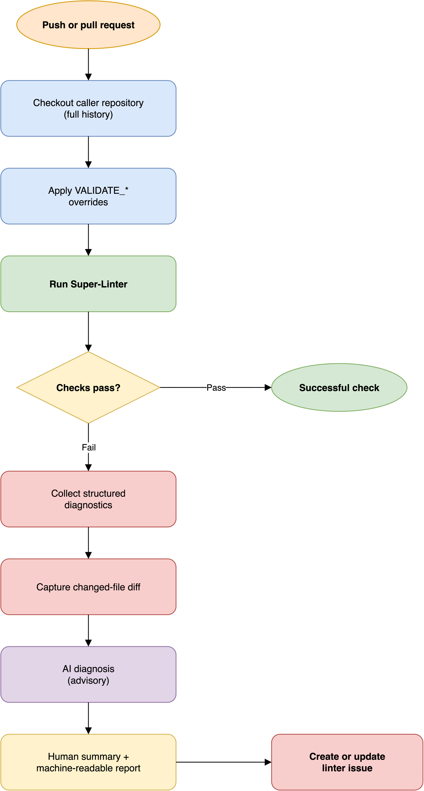

# How the linter workflow works

The linter workflow is the repository's continuous validation path.
It runs Super-Linter against the checked-out caller repository,
using the repository's own configuration files as the source of truth.
The workflow can run directly on pushes and pull requests,
or a caller can invoke its reusable `workflow_call` entry point.

## Validation flow

[Open the editable linter diagram](../assets/linter-workflow.drawio)

The workflow separates validation from repair.
Super-Linter determines whether checks pass.
The later steps preserve the evidence needed to understand a failure
and create a durable record for maintainers.

## Why configuration stays in the caller

The workflow sets `LINTER_RULES_PATH: /`,
so Super-Linter searches the checked-out repository for its configuration.
This allows each repository to keep its formatter rules,
language selection, and exceptions alongside its source code.

The optional `validate_overrides` input changes `VALIDATE_*` environment
variables for one caller.
It is an escape hatch for repository differences,
not a replacement for committed linter configuration.

## Preserve logs for later repair

When Super-Linter fails,
the workflow reads its saved output and selects JSON records with nonzero `Exitval`.
Each record keeps its original fields,
including any command and diagnostic messages.
The output file path identifies the source of each group of entries.
If structured failures are unavailable,
the reporter falls back to raw output.

The workflow does not generate a repository map or invoke an AI agent.
Its responsibility ends at recording evidence;
a separate repair skill can diagnose and fix the failure later.

## Why failures become issues

A GitHub issue is a durable handoff from CI to maintenance work.
It preserves the failure summary after the transient workflow log becomes
harder to find and gives maintainers a place to track the repair.
The `super-linter-issue` label makes these reports discoverable.

The reporter uses the `gh` CLI with `GITHUB_TOKEN`.
It searches for an existing open issue with the `super-linter-issue` label
and title `super-linter GitHub action has failed`
before deciding whether to comment on it or open a new one,
so repeated failures update one issue instead of creating duplicates.

Each report includes the commit SHA and workflow run attempt URL.
Reports that exceed the issue size budget are truncated with a notice,
so the workflow logs remain the source for complete evidence.

This step runs only after Super-Linter has failed.
Successful validation does not create maintenance noise.

## Permission and secret boundary

The workflow needs `contents: read` to inspect the repository
and `issues: write` so its `GITHUB_TOKEN` can create or comment on issues.
Fork pull request runs skip issue reporting because their token is read-only.
The workflow passes the caller's `GITHUB_TOKEN` to Super-Linter
and to the reporter as `GH_TOKEN`.
No custom secret is required;
the optional `COPILOT_TOKEN` declaration only preserves compatibility for existing callers.

## Related documentation

- [Consume the linter workflow](../how-to-guides/consume-linter.md)
- [Linter workflow reference](../references/linter-workflow.md)
- [How the workflows fit together](workflows.md)
