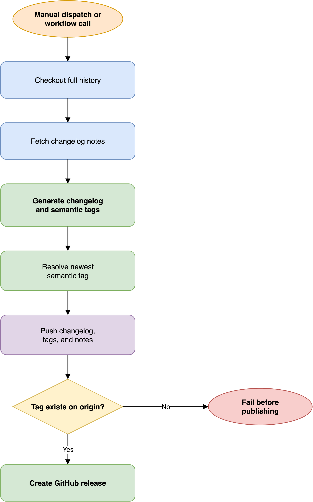

# How the release workflow works

The release workflow uses two invocations to separate preparation from publication.
The first generates or updates `CHANGELOG.md` and opens a pull request.
After that pull request is reviewed and merged,
a second invocation publishes the corresponding semantic tag and GitHub release.

## Release flow

[Open the editable release diagram](../assets/release-workflow.drawio)

Full history is required because changelog generation and semantic tag
selection depend on repository history.
The changelog generator runs at an immutable commit SHA
without a write token or persisted Git credentials.
The workflow does not carry `ai-changelog` Git notes between invocations.

## Changelog and release boundaries

The changelog tool determines the semantic version and writes the changelog.
The preparation invocation commits only `CHANGELOG.md` to a release branch
and opens a pull request against the default branch.
It does not push tags or create a release.
The publication invocation must run from the default branch after the pull request is merged;
it reads the first released version in `CHANGELOG.md` and uses its first three
sections as the release body.

This design keeps version calculation in one tool
while leaving publication in the GitHub Actions workflow.

## Publication safety

Only the trusted pull-request and explicit `publish: true` steps receive
write credentials.
It verifies that the tag does not already exist,
requires the default branch,
then pushes the tag and creates the GitHub release.

## Permission boundary

The workflow requests `contents: write` and `pull-requests: write`.
The preparation step does not receive the token;
the credential is exposed only to the trusted pull-request or publication steps.

Release is intentionally a manual path.
Dispatch `release.yml` to prepare a PR.
After it is reviewed and merged,
dispatch `publish-release.yml` from the default branch to publish the release.
The publishing entry point calls the reusable workflow with `publish: true`;
neither manual entry point accepts inputs.

## Related documentation

- [Workflow catalog](../../.github/workflows/README.md)
- [How the workflows fit together](workflows.md)
- [Release workflow source](https://github.com/electrocucaracha/gh-workflows/blob/main/.github/workflows/release.yml)
