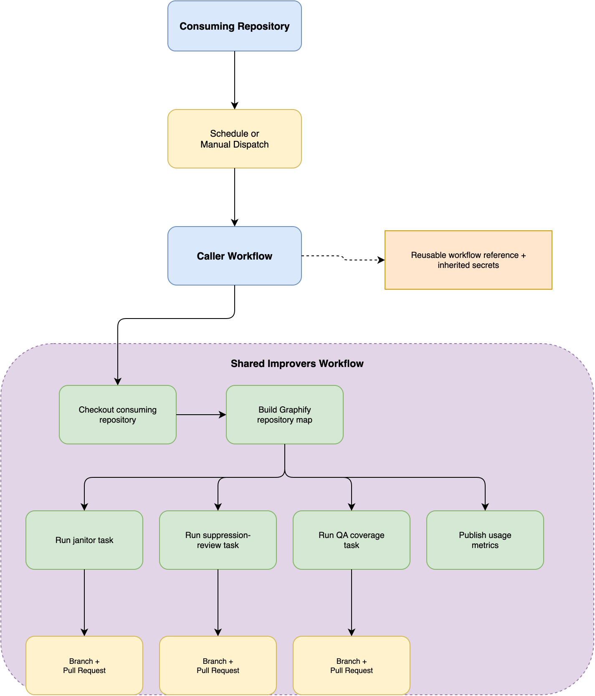

# Consume and customize the improvers workflow

Use a caller workflow when you want the upstream maintenance logic and prompts to stay centrally managed.



## Add the minimal caller

Create `.github/workflows/improvers.yml` in the consuming repository:

```yaml
name: "Maintenance: Code Base Quality Improvements"

"on":
  schedule:
    - cron: "0 0 15 * *"
  workflow_dispatch:

permissions: read-all

jobs:
  improvers:
    permissions:
      contents: write
      pull-requests: write
      issues: write
    uses: electrocucaracha/gh-workflows/.github/workflows/improvers.yml@main
    secrets: inherit
```

The called job needs `contents: write` to push branches,
`pull-requests: write` to open pull requests,
and `issues: write` to create or update the perspective review issue and its label.
All three must be granted on the calling job.
Its `permissions` block sets omitted permissions to `none`,
even with workflow-level `permissions: read-all`.
The `secrets: inherit` setting makes the caller's `COPILOT_TOKEN` available to the reusable workflow.
See the [workflow permission catalog](../../.github/workflows/README.md#job-permissions) for every workflow's requirements.

## Install the required agents

Keep these files in the consuming repository:

| File                                  | Used by                                    | Purpose                                                      |
| ------------------------------------- | ------------------------------------------ | ------------------------------------------------------------ |
| `.github/agents/janitor.agent.md`     | `reduce-tech-debt`, `remove-ignored-rules` | Removes dead code and complexity, and resolves suppressions. |
| `.github/agents/qa-subagent.agent.md` | `improve-code-coverage`                    | Finds coverage gaps and adds behavior-focused tests.         |

The agent names in their frontmatter must continue to resolve from the matrix values in the reusable workflow.
Copy both files again when their upstream definitions change.
Copy the eight reviewer persona definitions from upstream `.github/agents/` as well,
because `perspective-review` selects one of them at random.
All participating agents must include `"graphify/*"` in their frontmatter `tools` lists.
The workflow fails before spending Copilot tokens if the selected caller agent still has an old allowlist.

## Change the schedule

Edit only the caller's `schedule` entry.
GitHub Actions cron expressions use Coordinated Universal Time (UTC).
For example,
run at 03:30 UTC every Monday:

```yaml
on:
  schedule:
    - cron: "30 3 * * 1"
  workflow_dispatch:
```

Keep `workflow_dispatch` so maintainers can run the workflow on demand.

## Pin the reusable workflow

The `@main` reference receives upstream changes immediately.
For stable and auditable runs,
replace it with a release tag or full commit SHA:

```yaml
uses: electrocucaracha/gh-workflows/.github/workflows/improvers.yml@<release-tag-or-commit-sha>
```

Review upstream changes before updating the pinned reference.

## Control cost and coverage evidence

The default model is `gpt-5.4-mini`,
autopilot continuation is disabled,
and each agent step is limited to ten minutes.
Override the model or provide coverage generation on the calling job:

```yaml
with:
  model: gpt-5.4-mini
  coverage-command: make coverage
  coverage-report: coverage.out
```

The coverage command must be trusted,
non-interactive workflow configuration.
Go repositories generate coverage automatically when no command is supplied.
For other languages,
use a command and report appropriate to the repository;
without coverage evidence,
the coverage agent is skipped with a notice.
Prefer a concise text report with uncovered function or line information.
Configured coverage generation failures fail the job rather than starting an agent without evidence.

Tasks skip existing open improvement pull requests and use bounded evidence plus a shallow Graphify query.
Graph queries use depth 1 and a 500-token output budget;
agents must stop and report unavailable or failing Graphify tools instead of silently scanning the repository.
Inspect native Copilot usage statistics in the agent step log and the per-task session log artifacts.
RTK statistics are output-compression metrics,
not billing totals.
See the [reference](../references/improvers-workflow.md#cost-controls-and-inputs) for all limits.

Consumers pinned to an older SHA must update their workflow reference to a release or commit containing these changes before the next execution.

## Use an organization secret

For several repositories,
an organization owner can create an Actions secret named `COPILOT_TOKEN` and grant access only to selected repositories.
Each caller can continue to use `secrets: inherit`.

The token remains tied to the account that generated it,
including its Copilot entitlement, premium-request allowance, and expiration.
Rotate it when its owner changes role or no longer maintains the automation.

## Troubleshoot a failed run

### The nested job requests a permission that is not allowed

If validation reports `run-improvers is requesting 'issues: write', but is only allowed 'issues: none'`,
add `issues: write` to the consuming workflow's calling job as shown above.
Reusable workflows cannot elevate permissions beyond the caller's grants.
Changing `COPILOT_TOKEN` will not resolve this validation error.

### Copilot authentication fails

- Confirm that `COPILOT_TOKEN` exists in the consuming repository or is accessible as an organization secret.
- Confirm that the token owner has an active Copilot subscription.
- Confirm that the fine-grained token has the account-level **Copilot Requests** permission.
- Confirm that organization policy permits Copilot CLI.
- Replace expired or revoked tokens.

### The custom agent is not found

Confirm both agent files exist on the ref that started the workflow,
under `.github/agents/` with their original filenames and valid frontmatter.

### Branch creation or pull request creation fails

Check **Settings** > **Actions** > **General** > **Workflow permissions**.
Confirm that organization or repository policy permits write operations from GitHub Actions.
Also confirm that branch protection and rulesets allow the automation to create its proposed branches.

### Validation fails

Run `make test` and `make lint` locally.
The workflow assumes those targets exist and are non-interactive.
Adapt the target repository's Makefile rather than changing the centrally managed prompt for one repository.
